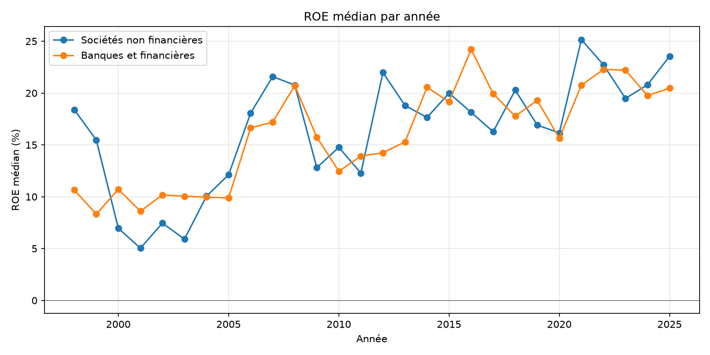
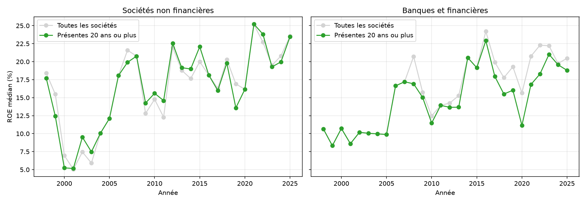
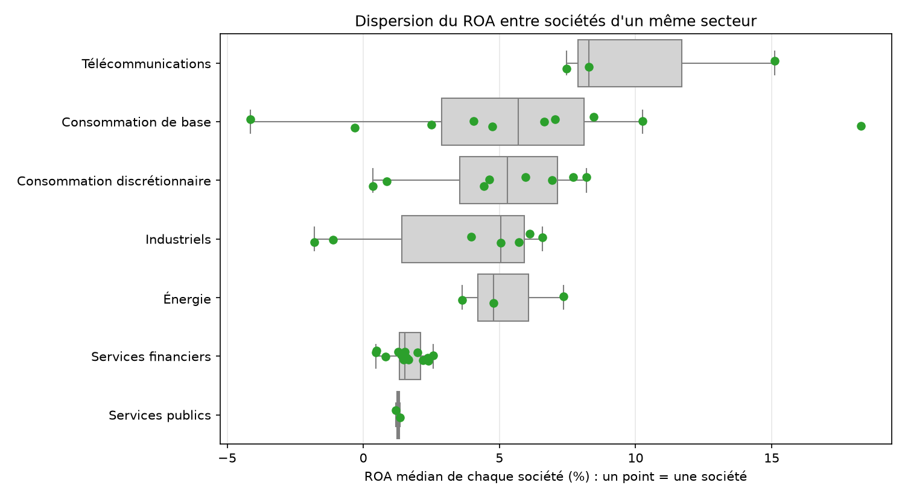

# Analyse financière des sociétés cotées à la BRVM (1998-2025)

Projet d'analyse des états financiers de 50 sociétés cotées à la Bourse Régionale des Valeurs Mobilières (BRVM) : audit de la qualité des données, calcul de ratios, comparaison de la rentabilité dans le temps et par secteur, et tests de robustesse.

> **Avertissement** : ce projet est descriptif. Il décrit des comptes passés et ne constitue ni un conseil ni une recommandation d'investissement.

## Sommaire

1. [Objectif du projet](#1-objectif-du-projet)
2. [Données et source](#2-données-et-source)
3. [Méthodologie](#3-méthodologie)
   - [3.1 Contrôle de la qualité](#31-contrôle-de-la-qualité)
   - [3.2 Formules des ratios](#32-formules-des-ratios)
   - [3.3 Calcul des médianes](#33-calcul-des-médianes)
4. [Résultats](#4-résultats)
   - [4.1 Évolution temporelle de la rentabilité](#41-évolution-temporelle-de-la-rentabilité)
   - [4.2 Comparaison sectorielle](#42-comparaison-sectorielle)
   - [4.3 Robustesse des résultats](#43-robustesse-des-résultats)
5. [Limites](#5-limites)
6. [Prochaines étapes](#6-prochaines-étapes)
7. [Structure du dépôt](#7-structure-du-dépôt)
8. [Reproduction](#8-reproduction)
9. [Avertissement et auteur](#9-avertissement-et-auteur)

## 1. Objectif du projet

Le projet cherche à répondre à quatre questions :

1. Les états financiers de la base sont-ils complets et cohérents ?
2. Comment la rentabilité des sociétés cotées a-t-elle évolué depuis 1998 ?
3. En quoi diffère-t-elle selon le type de société (financière ou non) et le secteur ?
4. Ces résultats résistent-ils aux choix de méthode ?

## 2. Données et source

- Les données sont issues de la base des états financiers des sociétés de la BRVM (bilan, compte de résultat, tableau des flux de trésorerie, depuis 1998) publiée par Oumar Dicko à partir des publications de la BRVM : [À COMPLÉTER : lien vers sa publication LinkedIn et vers la page Hugging Face].
- L'auteur de la base indique avoir contrôlé la cohérence des totaux et vérifié manuellement un échantillon par rapport aux rapports publiés. Les contrôles de ce projet ne constituent donc pas une vérification indépendante des chiffres.
- Analyse publiée avec l'accord de l'auteur de la base. Les données ne sont pas redistribuées dans ce dépôt : pour les obtenir, voir les liens ci-dessus.
- Ce projet n'est affilié ni à l'auteur de la base ni à la BRVM. Les contrôles, calculs et interprétations sont les miens.

**Contenu** : 50 sociétés (15 financières, 35 autres), exercices 1998 à 2025. Trois tableaux : bilan (1 032 lignes), compte de résultat (1 035 lignes), flux de trésorerie (939 lignes). Les postes sont des postes communs, moins détaillés que dans les rapports publiés (précision donnée par l'auteur de la base). Les montants sont en FCFA.

## 3. Méthodologie

### 3.1 Contrôle de la qualité

- Couverture par société et par année, doublons, cohérence entre les trois tableaux.
- Équilibre du bilan : actif = passif + capitaux propres sur 1 020 lignes comparables, sans écart supérieur à 0,1 %. Ce résultat confirme le contrôle annoncé par l'auteur de la base.
- Détection des sauts anormaux de total d'actif, des valeurs impossibles (par exemple un chiffre d'affaires négatif) et des lignes vides.
- Bilan : 24 années manquantes à l'intérieur des séries. Flux de trésorerie : 93 lignes société-année absentes, surtout pour des sociétés financières.
- Les anomalies sont consignées dans un journal de 12 lignes : [`outputs/journal_anomalies.csv`](outputs/journal_anomalies.csv). Beaucoup restent à vérifier dans les rapports annuels.
- **Classification** : les sociétés financières (banques) sont séparées des autres, car leurs comptes ne se lisent pas de la même façon. Les secteurs sont ceux de la liste de la BRVM, saisis à la main dans [`data/secteurs.csv`](data/secteurs.csv) ; trois sociétés disparues ou fusionnées ont été classées d'après leur activité.

### 3.2 Formules des ratios

**Conventions**

- **Valeurs de clôture** : tous les ratios utilisent les montants de fin d'exercice, et non des moyennes entre début et fin d'exercice. Ce choix évite de perdre les lignes dont l'année précédente est absente, mais les valeurs diffèrent un peu de celles calculées sur moyennes.
- Un ratio n'est calculé que si son **dénominateur est strictement positif** ; sinon il reste vide.
- Les montants sont en FCFA, les ratios n'ont pas d'unité (ils sont affichés en %).
- Le fichier ne précise pas si le résultat net est le résultat total ou la part du groupe ; il est utilisé tel que fourni, alors que les capitaux propres incluent la part des minoritaires.

| Ratio | Formule | Remarque |
|---|---|---|
| **ROE** (rentabilité des capitaux propres) | `Résultat net ÷ Capitaux propres (intérêts + part minoritaire)` | Capitaux propres de clôture |
| **ROE fiable** | `ROE`, calculé seulement si `Capitaux propres > 1 % du Total actif` | Écarte les cas où le ratio n'a pas de sens ; effet mesuré en 4.3 |
| **ROA** (rentabilité de l'actif) | `Résultat net ÷ Total actif` | Total actif de clôture, calculé pour toutes les années |
| **Levier** | `Total actif ÷ Capitaux propres` | Calculé seulement si `Capitaux propres > 1 % du Total actif`. Un levier de 10 signifie un actif égal à 10 fois les capitaux propres |
| **Marge nette** | `Résultat net ÷ Chiffre d'affaires` | Sociétés non financières |
| **Marge d'exploitation** | `Résultat d'exploitation ÷ Chiffre d'affaires` | Sociétés non financières |
| **Endettement** | `(Dette financière long terme + Dette financière court terme) ÷ Capitaux propres` | Capitaux propres de clôture |
| **Liquidité générale** | `Total actif courant ÷ Total passif courant` | Sociétés non financières |
| **Croissance du chiffre d'affaires** | `CA(t) ÷ CA(t-1) - 1` | Calculée seulement entre deux années consécutives avec CA(t-1) > 0 |
| **Flux de trésorerie libre** | `Net cash des opérations + Cash d'acquisition d'immobilisations` | Le second terme est négatif dans la base ; montant en FCFA |
| **Conversion en trésorerie** | `Net cash des opérations ÷ Résultat net` | Calculée seulement si le résultat net est positif |
| **Coefficient d'exploitation** (banques) | `1 - Résultat brut d'exploitation ÷ Produit net bancaire` | Part du produit net bancaire absorbée par les charges |
| **Coût du risque / PNB** (banques) | `valeur absolue du Coût du risque ÷ Produit net bancaire` | Le coût du risque est pris en valeur absolue |
| **Crédits / dépôts** (banques) | `Créances sur la clientèle ÷ Dépôts de la clientèle` | |

**Lien entre ROE, ROA et levier** : `ROE = ROA × Levier`. Pour une ligne donnée, c'est une identité (`Résultat net ÷ Capitaux propres = Résultat net ÷ Actif × Actif ÷ Capitaux propres`). Un ROE élevé peut donc venir d'un ROA élevé, d'un levier élevé, ou des deux. Cette relation ne se vérifie qu'approximativement sur des médianes.

### 3.3 Calcul des médianes

Trois méthodes sont utilisées ; la différence peut modifier les résultats (voir 4.3).

| Méthode | Principe | Utilisée pour |
|---|---|---|
| **A. Médiane des observations** | On met ensemble toutes les lignes société-année d'un groupe (par exemple les sociétés non financières d'une année, ou d'une période) et on prend la médiane | Courbes par année, tableaux par période |
| **B. Médiane par société, puis médiane entre sociétés** | On calcule d'abord la médiane de chaque société (au moins 5 années de ratios), puis la médiane de ces valeurs au sein du secteur | Comparaison sectorielle (4.2) |
| **C. Échantillon stable** | Méthode A restreinte aux sociétés présentes au moins 20 ans dans la base (24 non financières, 6 banques) | Tests de robustesse |

La méthode A donne plus de poids aux sociétés présentes longtemps, car elles apportent plus de lignes. La méthode B donne le même poids à chaque société, quel que soit son nombre d'années.

## 4. Résultats

Chaque résultat est présenté en trois temps :

- **Constat** : ce que montrent les chiffres.
- **Interprétation** : ce qu'ils peuvent signifier. Ce sont des hypothèses, sauf mention contraire.
- **Implication financière** : ce que cela change pour la lecture des comptes d'une entreprise.

Aucun résultat ne mesure la performance boursière : le projet n'utilise aucun cours ni aucune valorisation.

### 4.1 Évolution temporelle de la rentabilité

**Résultat 1 : le ROE médian des sociétés non financières a doublé entre 1998-2005 et 2006-2015, puis s'est stabilisé.**

| Période | ROE médian (méthode A) | Encadrement (pire cas / meilleur cas) |
|---|---|---|
| 1998-2005 | 10,0 % | 8,5 % à 11,5 % |
| 2006-2015 | 18,1 % | 16,3 % à 20,2 % |
| 2016-2025 | 20,4 % | 19,2 % à 21,1 % |

- **Constat** : le ROE médian passe de 10,0 % à 18,1 %, puis 20,4 %. Pour les 24 sociétés non financières présentes au moins 20 ans, le ROA médian est de 3,6 %, 6,8 % puis 5,8 %, et la marge nette de 3,4 %, 5,4 % puis 4,8 %. Les courbes montrent un creux entre 2000 et 2003 et un sommet vers 2021.
- **Interprétation** : entre les deux premières périodes, ROE, ROA et marge progressent ensemble : la hausse reflète en partie une meilleure rentabilité de l'activité. Entre les deux dernières, le ROE se maintient alors que le ROA et la marge reculent, ce qui est compatible avec des capitaux propres plus faibles par rapport à l'actif (hypothèse non testée). Les rapprochements avec des événements (crise ivoirienne de 2000-2003, crise financière de 2009, crise de 2010-2011) sont des hypothèses : les dates coïncident, mais aucun lien de cause n'est testé.
- **Implication financière** : le ROE seul ne suffit pas à juger une entreprise. Il doit être lu avec le ROA, la marge et le levier. La hausse du ROE médian **ne démontre ni une amélioration de la performance boursière, ni une meilleure qualité de chaque entreprise** : elle décrit la médiane d'un échantillon qui change d'année en année.

**Résultat 2 : le ROE médian des banques et financières augmente, mais son niveau récent dépend de l'échantillon.**

- **Constat** : le ROE médian des financières passe de 9,9 % à 15,8 %, puis 20,8 % (4 à 15 banques par année). Le saut de 2006 et le sommet de 2016 se retrouvent chez les 6 banques présentes au moins 20 ans. À partir de 2017, leur courbe est inférieure d'environ 2 à 5 points à celle de l'ensemble.
- **Interprétation** : les banques entrées plus récemment ont peut-être un ROE plus élevé et tirent la médiane vers le haut (hypothèse). Le ROA médian des banques est de 1,5 % pour un levier de 11,3 : leur ROE s'explique surtout par un bilan très grand par rapport à leurs capitaux propres.
- **Implication financière** : le ROE d'une banque se compare à celui d'autres banques, pas à celui d'une société industrielle ou commerciale. Avec si peu de banques par année, les variations de quelques points d'une année à l'autre ne sont pas significatives.

### 4.2 Comparaison sectorielle

**Résultat 3 : la rentabilité de l'actif diffère selon les secteurs, mais l'écart entre sociétés d'un même secteur est souvent plus grand.**

Méthode B, sociétés avec au moins 5 années de ratios (48 sur 50) :

| Secteur | Sociétés | ROA médian | Plus bas / plus haut | Levier médian |
|---|---|---|---|---|
| Télécommunications | 3 | 8,3 % | 7,5 % / 15,1 % | 2,9 |
| Consommation de base | 10 | 5,7 % | -4,1 % / 18,3 % | 2,2 |
| Consommation discrétionnaire | 8 | 5,3 % | 0,4 % / 8,2 % | 2,6 |
| Industriels | 7 | 5,0 % | -1,8 % / 6,6 % | 2,6 |
| Énergie | 3 | 4,8 % | 3,6 % / 7,4 % | 3,7 |
| Services financiers | 15 | 1,5 % | 0,5 % / 2,6 % | 11,3 |
| Services publics | 2 | 1,3 % | 1,2 % / 1,4 % | 16,2 |

- **Constat** : les télécoms ont le ROA médian le plus élevé, les services financiers et les services publics le plus bas. Dans la consommation de base, les sociétés vont de -4,1 % à 18,3 % de ROA ; chez les industriels, de -1,8 % à 6,6 %.
- **Interprétation** : la dispersion à l'intérieur d'un secteur hétérogène (la consommation de base regroupe agro-industrie, brasserie, tabac, alimentaire) limite la portée d'une médiane sectorielle. Les secteurs de 2 à 3 sociétés (services publics, télécoms, énergie) sont des études de cas, pas des tendances sectorielles.
- **Implication financière** : appartenir à un secteur ne résume pas la situation d'une entreprise ; l'analyse doit se faire société par société. Le ROA des banques ne se compare pas à celui des autres secteurs : leur bilan est structurellement très grand par rapport à leur résultat.

**Résultat 4 : un ROE élevé peut coexister avec un ROA faible (effet de levier).**

- **Constat** : les services publics ont un ROA médian de 1,3 % et un levier médian de 16,2, pour un ROE fiable médian de 21,5 % sur 1998-2025 et de 25,0 % sur 2016-2025 (méthode A). Les services financiers ont un ROA de 1,5 %, un levier de 11,3 et un ROE de 16,8 % puis 20,8 %. Dans les autres secteurs, le levier médian reste entre 2,2 et 3,7.
- **Interprétation** : avec un actif égal à 11 à 16 fois les capitaux propres, un faible ROA donne un ROE élevé. Ce ROE ne signale pas une activité très rentable. Pour les services publics, le résultat repose sur 2 sociétés seulement.
- **Implication financière** : comparer des ROE sans comparer des leviers est trompeur. Le ROE d'un secteur très endetté ne se compare pas à celui d'un secteur peu endetté.

### 4.3 Robustesse des résultats

**Test 1 : changement de composition de l'échantillon (méthode C)**

- **Constat** : pour les sociétés non financières, la courbe du ROE des sociétés présentes au moins 20 ans suit de près celle de l'ensemble (creux de 2000 à 2003, sommet de 2021). Pour les banques, les courbes divergent à partir de 2017.
- **Interprétation** : l'évolution des sociétés non financières ne vient pas des entrées et sorties de sociétés. Celle des banques en dépend en partie.
- **Implication financière** : la tendance des sociétés non financières est solide ; le niveau récent de rentabilité des banques est à présenter avec les deux échantillons.

**Test 2 : le filtre du « ROE fiable »**

- **Constat** : le filtre écarte 62 lignes, toutes des sociétés non financières, soit 5,8 % à 9,8 % des lignes selon la période. Parmi les lignes écartées, 64,5 % ont un résultat net négatif, contre 11,8 % parmi celles conservées. En supposant que toutes les lignes écartées aient le ROE le plus bas ou le plus haut possible, la médiane ne bouge que de 1 à 2 points. Au niveau d'une société, l'effet peut être très fort : pour UNILEVER CI, 53 % des années sont écartées, le ROA médian de toutes les années est de -4,1 % et le ROE fiable médian de +50,8 %.
- **Interprétation** : le filtre retire surtout des années de pertes, donc il flatte le ROE des sociétés qui en ont subi. Au niveau agrégé, l'effet reste limité ; au niveau d'une société, il peut rendre le ROE ininterprétable.
- **Implication financière** : pour comparer des sociétés, le ROA (calculé sur toutes les années) est préférable ; un ROE doit toujours être accompagné du pourcentage d'années écartées.

**Test 3 : méthode de calcul des médianes (A contre B)**

ROA médian par secteur, en %, calculé de deux façons :

| Secteur | Méthode A (observations) | Méthode B (par société) | Écart (B - A) |
|---|---|---|---|
| Télécommunications | 12,6 | 8,3 | -4,3 |
| Consommation de base | 6,4 | 5,7 | -0,7 |
| Consommation discrétionnaire | 5,3 | 5,3 | 0,0 |
| Énergie | 5,2 | 4,8 | -0,4 |
| Industriels | 4,1 | 5,0 | +0,9 |
| Services financiers | 1,5 | 1,5 | 0,0 |
| Services publics | 1,3 | 1,3 | 0,0 |

La méthode A porte sur toutes les sociétés du secteur ; la méthode B exclut les sociétés qui ont moins de 5 années de ratios (LNB et TOTAL SENEGAL), ce qui réduit aussi le nombre de sociétés de la consommation discrétionnaire (9 à 8) et de l'énergie (4 à 3).

- **Constat** : l'écart est nul ou faible pour la plupart des secteurs, mais il atteint 4,3 points pour les télécoms et 0,9 point pour les industriels.
- **Interprétation** : la méthode A donne plus de poids aux sociétés présentes longtemps, la méthode B met toutes les sociétés sur le même plan, y compris celles qui n'ont que 5 années de données (Orange CI, par exemple).
- **Implication financière** : le choix de la médiane peut changer l'ampleur d'un écart sectoriel. Une comparaison de secteurs n'a de sens que si la méthode est précisée.

## 5. Limites

- **Biais de survie** : l'échantillon des sociétés présentes au moins 20 ans favorise les survivantes.
- **Peu de banques par année** (4 à 15 pour le ROE) : leurs médianes sont fragiles.
- **Petits secteurs** : services publics (2 sociétés), télécoms (3) et énergie (3) sont des études de cas.
- **Filtre du ROE** : il écarte surtout des années de pertes (voir 4.3). Le ROA est préféré pour comparer des sociétés.
- **Valeurs de clôture** : les ratios ne sont pas calculés sur des moyennes de début et de fin d'exercice.
- **Composition changeante** : des sociétés entrent et sortent de la base ; NEI CI et CEDA CI (jusqu'en 2010) deviennent NEI CEDA CI (2011) ; les données de CROWN CI, MOVIS CI et UNILEVER CI s'arrêtent avant 2024 pour une raison non vérifiée.
- **Sociétés majoritairement ivoiriennes** : les résultats ne représentent pas toute la zone UEMOA.
- **Classification sectorielle** saisie à la main.
- **Aucune donnée de marché** : ni cours, ni valorisation, ni dividende par action, ni liquidité. Le projet ne mesure pas la performance boursière.
- **Hypothèses non testées** : les liens avec des événements économiques ne sont pas vérifiés.
- **Anomalies de données** non vérifiées dans les rapports annuels.

## 6. Prochaines étapes

- Rendre les notebooks reproductibles (découpage en notebooks numérotés, fonctions dans `src/`).
- Vérifier les anomalies du journal dans les rapports annuels et ajouter les sources.
- Étudier la régularité et le niveau des dividendes versés (feuille des flux).
- Comparer le résultat net et la trésorerie réellement générée (qualité des bénéfices).
- Ajouter les indicateurs propres aux banques et une comparaison par pays.

## 7. Structure du dépôt

| Élément | Contenu |
|---|---|
| [`notebooks/`](notebooks/) | Analyses : exploration, contrôles de qualité, ratios, graphiques |
| [`outputs/`](outputs/) | Graphiques et [journal des anomalies](outputs/journal_anomalies.csv) |
| [`data/secteurs.csv`](data/secteurs.csv) | Classification sectorielle ; les données financières ne sont pas publiées |
| [`requirements.txt`](requirements.txt) | Bibliothèques utilisées |

## 8. Reproduction

1. Installer les bibliothèques : `pip install -r requirements.txt`.
2. Obtenir la base auprès de son auteur (voir la section 2) et la placer dans `data/raw/`.
3. Exécuter le notebook `notebooks/01_exploration.ipynb` de haut en bas.

## 9. Avertissement et auteur

Ce projet est réalisé à des fins d'apprentissage et d'analyse descriptive. Il ne constitue pas un conseil en investissement.

Auteur : [À COMPLÉTER : votre nom et un lien LinkedIn]